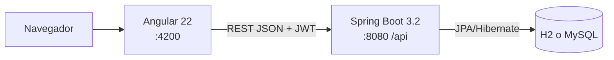

# UrbanAlert

**Sistema web para la gestión y seguimiento de incidencias urbanas.**

Los vecinos reportan problemas de infraestructura (alumbrado público, pistas, veredas, semáforos, residuos sólidos, señalización e infraestructura pública). La municipalidad los recibe, los clasifica, los deriva al área responsable y hace el seguimiento hasta su resolución.

## Objetivo

Centralizar en una sola plataforma el registro de incidencias: qué ocurre, dónde, quién lo reportó, qué área lo atiende, con qué prioridad y en qué estado está, con trazabilidad de cada cambio.

## Funcionalidades

**Portal ciudadano**
- Registro de cuenta e inicio de sesión.
- Reporte de incidencias con categoría, urgencia y dirección.
- Consulta de sus reportes, su estado y el historial de atención.
- Edición o eliminación mientras el reporte no fue atendido. Edición del perfil.

**Panel municipal (administrador y operador de área)**
- Dashboard con indicadores reales: totales por estado y categoría, vencidas, tiempo promedio de resolución.
- Bandeja de incidencias con búsqueda, filtros, orden y paginación.
- Gestión: cambio de estado con flujo validado, derivación a un área, cambio de categoría y prioridad, historial.
- Registro presencial a nombre de un vecino.
- Administración de ciudadanos, áreas responsables y usuarios del personal.
- Reportes de incidencias vencidas con exportación a CSV.
- Seguridad por rol: el operador solo ve y atiende las incidencias de su área.

## Tecnologías

| Capa | Tecnología |
|---|---|
| Frontend | Angular 22.2 · TypeScript 6 · RxJS 7.8 · SCSS · Vitest |
| Backend | Java 17 · Spring Boot 3.2.5 (Web, Data JPA, Validation, Security) · jjwt 0.12.5 · Lombok · Maven |
| Base de datos | H2 en memoria (desarrollo) · MySQL 8+ (perfil `mysql`) |
| Autenticación | JWT (HS256) + BCrypt · roles `ADMIN`, `OPERADOR`, `CIUDADANO` |

## Arquitectura



El frontend solo presenta y valida. La autorización, las reglas de negocio y el historial están en el backend. Detalle en [docs/ARQUITECTURA.md](docs/ARQUITECTURA.md).

## Estructura del repositorio

```
URBANALERT/
├── backend/                 API Spring Boot (Maven)
│   ├── src/main/java/...    config, controller, service, repository, model, dto, security, exception
│   ├── src/test/            pruebas JUnit/Mockito/MockMvc
│   ├── postman/             colección Postman
│   ├── .env.example         variables de entorno (copiar a .env)
│   ├── pom.xml
│   └── README.md
├── frontend/                SPA Angular 22
│   ├── src/app/             core, shared, layouts, features (auth, portal, panel)
│   ├── src/environments/    URL de la API
│   ├── package.json · angular.json
│   └── README.md
├── docs/                    documentación técnica
├── .gitignore
└── README.md
```

## Requisitos

- **JDK 17** y **Maven 3.6.3+**
- **Node.js 22.22+ o 24.15+** con **npm 11**
- **MySQL 8+**, solo si se quiere persistencia (por defecto se usa H2 en memoria)
- Git

## Inicio rápido

```bash
git clone https://github.com/AlvaroFabrizioZapataYarleque/URBANALERT.git
cd URBANALERT
```

**1. Backend** (terminal 1)

```bash
cd backend
cp .env.example .env
# Edite .env y complete JWT_SECRET con el resultado de:  openssl rand -base64 48
mvn spring-boot:run
```

API en `http://localhost:8080/api` (prueba rápida: `curl http://localhost:8080/api/publico/resumen`).

**2. Frontend** (terminal 2)

```bash
cd frontend
npm install
npm start
```

Abra `http://localhost:4200`.

**3. Usuarios de prueba**

| Usuario | Contraseña | Acceso |
|---|---|---|
| `admin` | `Admin123*` | Panel municipal completo |
| `op.alumbrado` | `Operador123*` | Panel, limitado a su área |
| `maria` | `Ciudadano123*` | Portal ciudadano |

También puede crear una cuenta de ciudadano desde "Regístrese".

## Base de datos

- **Por defecto**: H2 en memoria. No requiere instalación y se reinicia con cada arranque. Consola en `http://localhost:8080/h2-console`.
- **MySQL**: complete `DB_USER`, `DB_PASSWORD` (y `DB_URL` si hace falta) en `backend/.env` y ejecute `mvn spring-boot:run -Dspring-boot.run.profiles=mysql`. La base `urbanalert` y sus tablas se crean automáticamente.

Detalle en [docs/BASE_DE_DATOS.md](docs/BASE_DE_DATOS.md).

## Documentación

| Documento | Contenido |
|---|---|
| [backend/README.md](backend/README.md) | Instalación, ejecución, pruebas y problemas frecuentes del backend |
| [frontend/README.md](frontend/README.md) | Instalación, configuración de la API, build y pruebas del frontend |
| [docs/ARQUITECTURA.md](docs/ARQUITECTURA.md) | Arquitectura, autenticación, roles y flujos (con diagramas) |
| [docs/BASE_DE_DATOS.md](docs/BASE_DE_DATOS.md) | Motores, tablas, relaciones, datos iniciales y preparación |
| [docs/API_ENDPOINTS.md](docs/API_ENDPOINTS.md) | Endpoints públicos y protegidos, filtros y errores |
| [docs/CONFIGURACION_ENTORNO.md](docs/CONFIGURACION_ENTORNO.md) | Versiones, variables de entorno, puertos y perfiles |
| [docs/GUIA_DESARROLLO.md](docs/GUIA_DESARROLLO.md) | Convenciones, cómo agregar módulos y endpoints, flujo de Git |
| [docs/AUDITORIA_Y_ARQUITECTURA_FRONTEND.md](docs/AUDITORIA_Y_ARQUITECTURA_FRONTEND.md) | Auditoría del backend, mapeo de pantallas y limitaciones conocidas |

## Seguridad

- El secreto JWT **no** está en el repositorio: cada entorno define `JWT_SECRET` en `backend/.env` (ignorado por Git) o como variable de entorno.
- Las credenciales de la tabla anterior son solo de demostración y las crea `DataLoader` en todos los perfiles. Cámbielas antes de usar una base de datos real.
