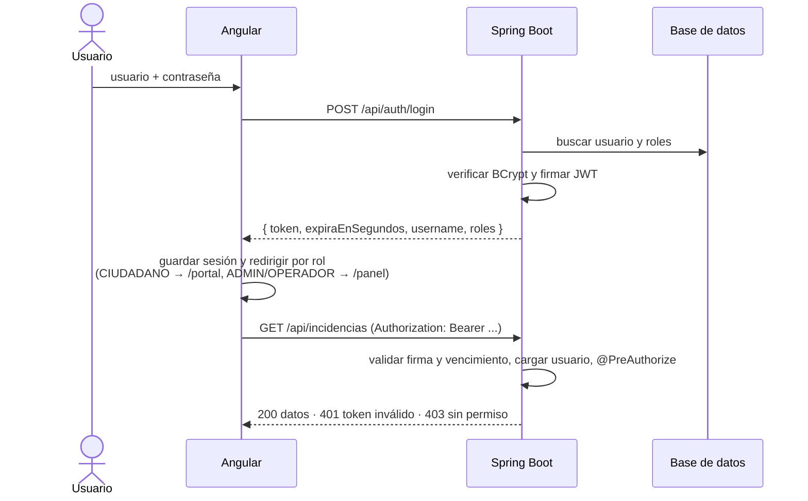
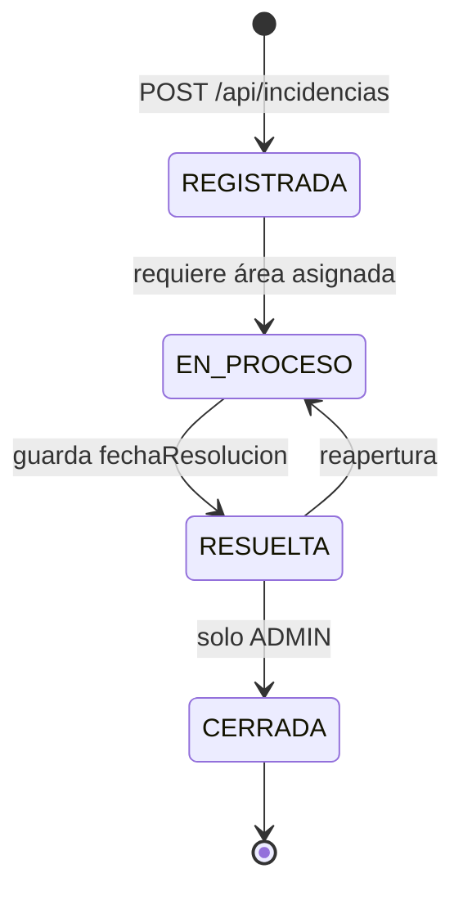

# Arquitectura de UrbanAlert

UrbanAlert es una aplicación web de dos capas que se comunican por HTTP/JSON:

- **Frontend**: SPA en Angular 22 (`frontend/`). Presenta la interfaz y llama a la API.
- **Backend**: API REST en Spring Boot 3.2.5 (`backend/`). Contiene las reglas de negocio, la seguridad y el acceso a datos.
- **Base de datos**: H2 en memoria por defecto, o MySQL con el perfil `mysql`. Ver [BASE_DE_DATOS.md](BASE_DE_DATOS.md).

## Diagrama general

```mermaid
flowchart LR
    U[Navegador<br/>Ciudadano / Admin / Operador]

    subgraph FE[Frontend · Angular 22 · puerto 4200]
        R[Router + guards por rol]
        P[Páginas: portal y panel]
        S[Servicios HTTP<br/>core/api/apis.ts]
        I[Interceptores<br/>Bearer + sesión expirada]
    end

    subgraph BE[Backend · Spring Boot 3.2.5 · puerto 8080]
        F[JwtAuthenticationFilter]
        C[Controllers /api/**<br/>@PreAuthorize / @Secured]
        SV[Services<br/>reglas + @Transactional]
        RP[Repositories JPA + JPQL]
    end

    DB[(H2 en memoria<br/>o MySQL)]

    U --> R --> P --> S --> I
    I -- "HTTP JSON + Authorization: Bearer JWT" --> F --> C --> SV --> RP --> DB
```



## Responsabilidades

| Capa | Responsable de | No hace |
|---|---|---|
| Frontend | Pantallas, navegación, validación de formularios (mismas reglas que los DTO), guardar el token, mostrar u ocultar acciones según el rol, búsqueda/orden/paginación en el cliente | No decide permisos reales ni reglas de negocio |
| Backend | Autenticación, autorización por permiso y por dato, validación (Bean Validation), reglas de estado, historial, consultas e indicadores | No guarda sesión (es *stateless*) |
| Base de datos | Persistencia de usuarios, roles, ciudadanos, áreas, incidencias e historial | — |

### Capas del backend (`backend/src/main/java/com/utp/urbanalert`)

```
config/      SecurityConfig (seguridad, CORS), DataLoader (datos iniciales)
controller/  Endpoints REST. Seguridad declarada por método
service/     Interfaces + impl/ con las reglas de negocio (@Transactional)
repository/  Spring Data JPA + JPQL (incluye una consulta dinámica con filtros)
model/       Entidades JPA y enums (roles, permisos, estados, categorías, prioridades)
dto/         Request/Response con Bean Validation
mapper/      Entidad → DTO
security/    JwtService, JwtAuthenticationFilter, UserDetailsService, manejadores 401/403
exception/   Excepciones de negocio + GlobalExceptionHandler
```

### Capas del frontend (`frontend/src/app`)

```
core/       sesión (signals), guards, interceptores, servicios HTTP por controlador, modelos de los DTO
shared/     componentes reutilizables, pipes, utilidades
layouts/    público (login/registro) y shell (sidebar + barra superior)
features/   auth, portal (ciudadano) y panel (ADMIN/OPERADOR); cada página se carga bajo demanda
```

## Comunicación Angular ↔ Spring Boot

- URL base de la API: `environment.apiUrl` (`frontend/src/environments/`). Por defecto `http://localhost:8080/api`.
- CORS: el backend acepta solo los orígenes de `CORS_ALLOWED_ORIGINS` (por defecto `http://localhost:4200`), con los métodos GET, POST, PUT, DELETE y OPTIONS y las cabeceras `Authorization` y `Content-Type`.
- Formato: JSON. Las fechas llegan como `LocalDateTime` ISO sin zona (`2026-10-29T10:15:30.123`).
- Errores: `{ timestamp, status, mensaje }` o, en validaciones, `{ timestamp, status, errores: { campo: mensaje } }`. El frontend los traduce en `core/services/api-error.ts`.

## Autenticación (JWT)

- Token firmado con HS256 usando `JWT_SECRET`. Incluye `sub` (username), `roles`, `iat` y `exp`.
- Vigencia: `JWT_EXPIRATION_MS` (2 horas por defecto). No hay *refresh token*.
- Las contraseñas se guardan con BCrypt.
- El backend no guarda sesión. En cada solicitud, `JwtAuthenticationFilter` valida el token y vuelve a cargar al usuario desde la BD. Una cuenta deshabilitada deja de autenticarse aunque su token siga vigente.
- Frontend: guarda `{ token, username, roles, expiraEn }` en `localStorage` (`ua.session`). Cierra la sesión al vencer o ante cualquier `401` de una ruta protegida.



### Registro de ciudadanos

`POST /api/auth/register` crea en una sola transacción el perfil `Ciudadano` y la cuenta `Usuario`. El rol `CIUDADANO` lo asigna el servidor: el registro público no permite elegir otro rol. El personal municipal (ADMIN/OPERADOR) lo crea un ADMIN en `POST /api/usuarios`.

## Autorización por roles

Doble control en el backend:

1. **Por permiso**: `@PreAuthorize("hasAuthority('PERMISO')")` o `@Secured("ROLE_ADMIN")` en cada método.
2. **Por dato** (en el servicio): un ciudadano solo accede a sus incidencias y un operador solo a las de su área.

| Permiso | ADMIN | OPERADOR | CIUDADANO |
|---|:-:|:-:|:-:|
| INCIDENCIA_CREAR | ✔ | ✔ | ✔ |
| INCIDENCIA_VER | ✔ todas | ✔ su área | ✔ las suyas |
| INCIDENCIA_EDITAR | ✔ | | ✔ solo REGISTRADA |
| INCIDENCIA_CAMBIAR_ESTADO | ✔ | ✔ su área; no puede cerrar | |
| INCIDENCIA_ASIGNAR_AREA | ✔ | | |
| INCIDENCIA_ELIMINAR | ✔ | | ✔ solo REGISTRADA |
| CIUDADANO_GESTIONAR | ✔ | ✔ | |
| AREA_GESTIONAR | ✔ | | |
| REPORTE_VER | ✔ | | |

El frontend copia esta tabla (`core/auth/permisos.ts`) solo para mostrar u ocultar acciones. Los guards (`core/guards/auth.guards.ts`) separan `/portal` (CIUDADANO) de `/panel` (ADMIN, OPERADOR). Áreas, Usuarios y Reportes son solo para ADMIN.

## Flujo de una incidencia



1. **Registro**: el ciudadano la reporta desde el portal. El personal municipal también puede registrarla a nombre de un vecino (registro presencial, con `ciudadanoId` y `areaId` opcional). El estado inicial es `REGISTRADA` y se crea la primera entrada del historial.
2. **Clasificación**: el ADMIN ajusta la categoría y la prioridad (`PUT /api/incidencias/{id}`) y la deriva a un área (`PUT /api/incidencias/{id}/area`).
3. **Atención**: el ADMIN o el operador del área cambia el estado (`PUT /api/incidencias/{id}/estado`). El servidor valida que la transición esté permitida.
4. **Seguimiento**: cada alta, edición, derivación y cambio de estado agrega una fila a `historial_incidencias` en la misma transacción. Se consulta con `GET /api/incidencias/{id}/historial`.
5. **Indicadores**: `GET /api/reportes/indicadores` y `/pendientes` dan totales, incidencias vencidas y tiempos de resolución (solo ADMIN).

## Limitaciones conocidas

El backend no tiene endpoints para evidencias fotográficas, coordenadas o mapa, notificaciones, observaciones al cambiar de estado, ni paginación del lado del servidor. El detalle y las mejoras propuestas están en [AUDITORIA_Y_ARQUITECTURA_FRONTEND.md](AUDITORIA_Y_ARQUITECTURA_FRONTEND.md).
