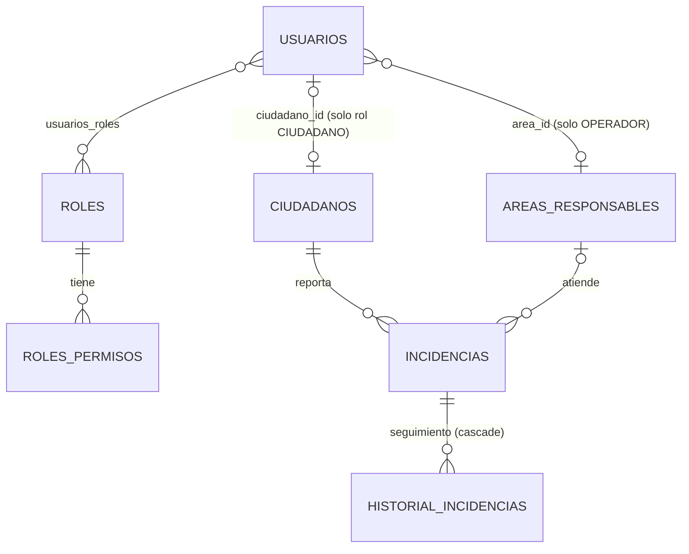

# Base de datos

Información obtenida de `backend/src/main/resources/application*.properties`, de las entidades en `backend/src/main/java/com/utp/urbanalert/model/` y de `config/DataLoader.java`.

## Motores soportados

| | Perfil por defecto | Perfil `mysql` |
|---|---|---|
| Motor | H2 en memoria | MySQL |
| Versión | H2 **2.2.224** (driver del BOM de Spring Boot 3.2.5, verificado con `mvn dependency:list`) | Driver `mysql-connector-j` **8.3.0** (verificado). Versión del servidor: el comentario del archivo pide "MySQL 8+". **Pendiente de confirmar** con qué versión de servidor la usa el equipo |
| Base de datos | `urbanalertdb` | `urbanalert` (se crea sola: `createDatabaseIfNotExist=true`) |
| URL | `jdbc:h2:mem:urbanalertdb;DB_CLOSE_DELAY=-1` | `jdbc:mysql://localhost:3306/urbanalert?...&serverTimezone=America/Lima` (se puede cambiar con `DB_URL`) |
| Usuario / contraseña | `sa` / vacía (base local en memoria) | `DB_USER` (por defecto `root`) / `DB_PASSWORD` (por defecto vacía) |
| Persistencia | Se pierde al detener la aplicación | Persistente |
| Consola | `http://localhost:8080/h2-console` | — |

Verificación realizada: el perfil H2 se ejecutó y se probó (arranque, login y consultas). El perfil `mysql` **no** se ejecutó en esta revisión porque no había un servidor MySQL activo.

## Esquema: generación y migraciones

- `spring.jpa.hibernate.ddl-auto=update` en ambos perfiles: **Hibernate crea y actualiza las tablas** a partir de las entidades al arrancar.
- **No hay Flyway, Liquibase ni scripts SQL** en el proyecto.
- `spring.jpa.open-in-view=false` y `spring.jpa.show-sql=true` (registra el SQL en la consola).

> Para producción conviene reemplazar `ddl-auto=update` por migraciones versionadas (Flyway o Liquibase).

## Tablas y entidades

Nombres tomados de las anotaciones `@Table`, `@JoinTable` y `@CollectionTable`.

| Tabla | Entidad | Campos principales |
|---|---|---|
| `usuarios` | `Usuario` | `id`, `username` (único, 50), `password` (hash BCrypt), `enabled`, `fecha_creacion`, `ciudadano_id` (único, opcional), `area_id` (opcional) |
| `roles` | `Rol` | `id`, `nombre` (único: `ADMIN`, `OPERADOR`, `CIUDADANO`) |
| `roles_permisos` | colección de `Rol.permisos` | `rol_id`, `permiso` (enum `Permiso`) |
| `usuarios_roles` | relación N:M | `usuario_id`, `rol_id` |
| `ciudadanos` | `Ciudadano` | `id`, `nombre` (120), `dni` (único, 15), `email` (120), `telefono` (20) |
| `areas_responsables` | `AreaResponsable` | `id`, `nombre` (único, 100), `descripcion` (250) |
| `incidencias` | `Incidencia` | `id`, `titulo` (150), `descripcion` (500), `categoria`, `prioridad`, `estado`, `direccion_referencial` (200), `fecha_reporte`, `fecha_actualizacion`, `fecha_resolucion`, `ciudadano_id` (obligatorio), `area_id` (opcional) |
| `historial_incidencias` | `HistorialIncidencia` | `id`, `incidencia_id`, `estado_anterior`, `estado_nuevo`, `detalle` (300), `realizado_por` (50), `fecha` |

Los nombres de columna en *snake_case* siguen la estrategia de nombres por defecto de Spring Boot. Los enums se guardan como texto (`EnumType.STRING`).

## Relaciones



- Al eliminar una incidencia se elimina su historial (`cascade = ALL`, `orphanRemoval = true`).
- No se puede eliminar un área con incidencias o personal asignado (lo controla el servicio y responde 409).
- Un ciudadano puede existir sin cuenta: lo registra el personal municipal en `POST /api/ciudadanos`.

## Datos iniciales (`DataLoader`)

Al arrancar, si la tabla `roles` está vacía, se cargan:

- Roles y permisos (indispensables).
- 5 áreas: Alumbrado Publico, Pistas y Veredas, Semaforizacion, Limpieza Publica, Senalizacion Vial.
- Usuarios de prueba: `admin`, `op.alumbrado`, `op.pistas`, `op.semaforos`, `maria`, `jose`, `lucia` (contraseñas en `backend/README.md`).
- 4 ciudadanos y 8 incidencias con su historial.

La carga no se repite: con MySQL, en los siguientes arranques no inserta nada. **Advertencia:** `DataLoader` se ejecuta en todos los perfiles, incluido `mysql`. Antes de usar una base real, cambie las contraseñas de prueba o limite la carga de ejemplo a desarrollo.

## Preparar la base de datos

### H2 (desarrollo, sin instalar nada)

No requiere pasos: la base se crea en memoria al ejecutar `mvn spring-boot:run`. Para inspeccionarla, abra `http://localhost:8080/h2-console` con JDBC URL `jdbc:h2:mem:urbanalertdb`, usuario `sa` y contraseña vacía.

### MySQL

1. Tener un servidor MySQL en ejecución (el proyecto indica MySQL 8+).
2. Opcional: crear la base y un usuario propio. La URL ya incluye `createDatabaseIfNotExist=true`, así que basta con un usuario que tenga permiso para crearla.
   ```sql
   CREATE DATABASE urbanalert CHARACTER SET utf8mb4 COLLATE utf8mb4_unicode_ci;
   CREATE USER 'urbanalert'@'localhost' IDENTIFIED BY '<contraseña>';
   GRANT ALL PRIVILEGES ON urbanalert.* TO 'urbanalert'@'localhost';
   ```
3. Definir `DB_USER` y `DB_PASSWORD` (y `DB_URL` si cambia el host, el puerto o el nombre) en `backend/.env` o como variables de entorno.
4. Ejecutar `mvn spring-boot:run -Dspring-boot.run.profiles=mysql` desde `backend/`. Hibernate crea las tablas y `DataLoader` carga los datos iniciales.
5. Verificar: el log muestra `Started UrbanAlertApplication` y `GET http://localhost:8080/api/publico/resumen` responde `"total": 8` en una base nueva.
